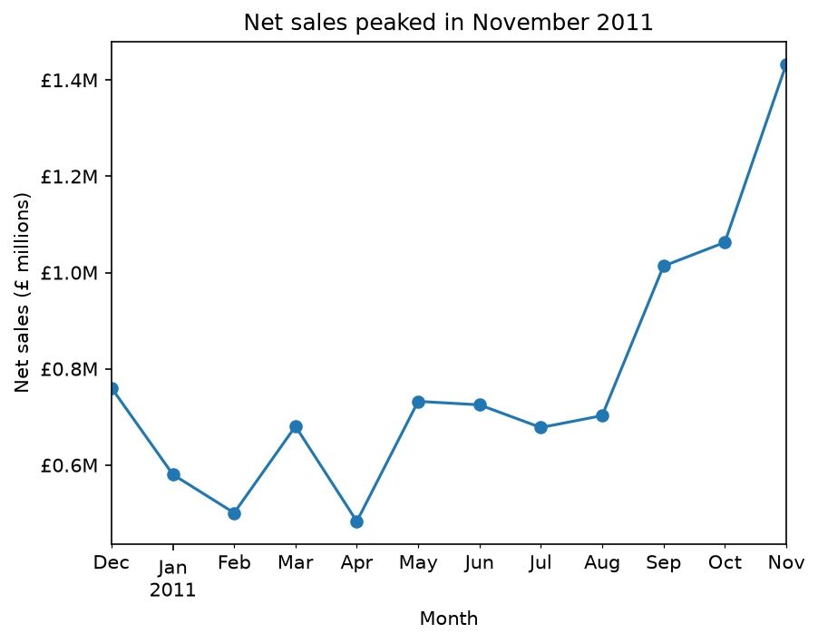
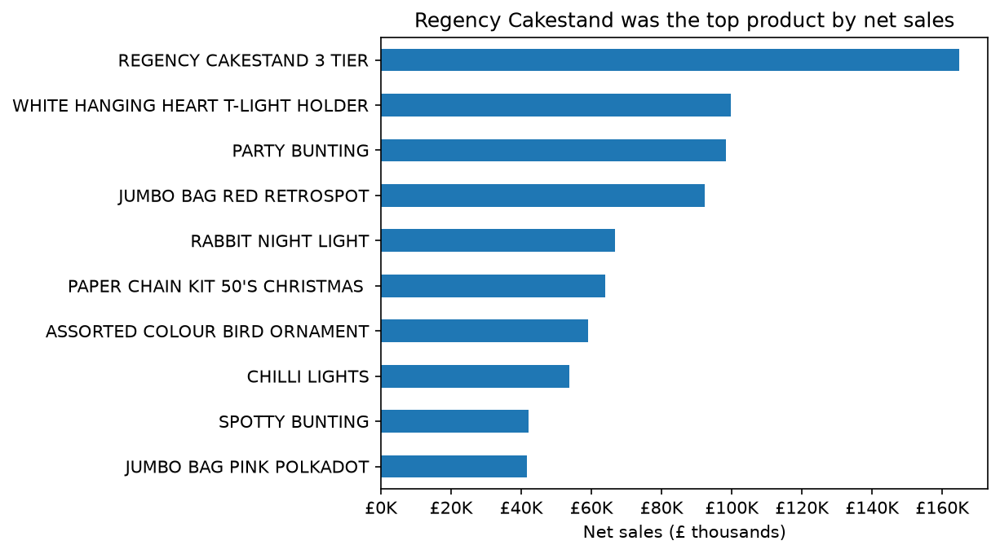
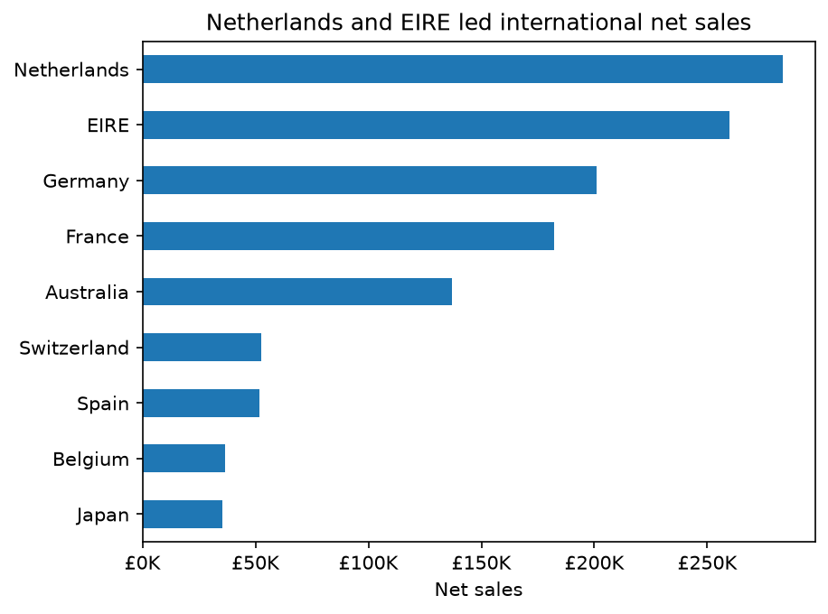
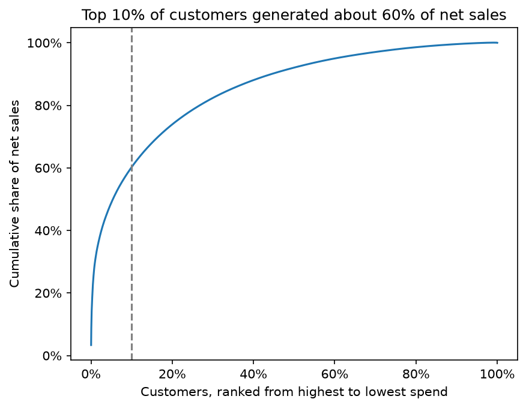

# Online Retail Data Analysis Using Python

Analysis of about 540,000 transactions from a UK-based online retailer (1 December 2010 to 9 December 2011). The project covers data cleaning, net sales trends, product and country performance, customer concentration, repeat purchasing and RFM segmentation.

**Status:** Core analysis complete. Not yet done: average order value, cancellation rate on a clean basis, cohort analysis, dashboard.

**Tools:** Python 3.14, pandas, NumPy, Matplotlib, Jupyter Notebook, Git and GitHub

## Business Questions

1. How much of the recorded sales value is real product revenue, and how should returns and fees be treated?
2. How do net sales change over time?
3. Which products and countries contribute most?
4. How concentrated is revenue among customers?
5. Do customers come back, and can they be segmented usefully?

## Key Findings

1. **Returns and fees distorted the raw total.** The original £9,747,747.93 splits into product sales (£10,272,121.42), cancellations (-£896,812.49) and non-product codes such as postage (£372,439.00). The groups reconcile to the original total.
2. **Two huge orders were cancelled within minutes** (invoices 581483 and 541431, about £245.7K combined). Because the cancellations were stored separately, one product (PAPER CRAFT, LITTLE BIRDIE) ranked second by gross value but had a net value of £0. Rankings and trends therefore use net sales, where cancellations offset their sales.
3. **November 2011 was the peak month** at £1,432,735 net sales, about 35% above October (£1,062,694). Sales rose from September onwards, which is consistent with a pre-Christmas build-up, but one year of data cannot confirm seasonality.
4. **REGENCY CAKESTAND 3 TIER was the top product** by net sales (£164,762).
5. **The UK generated 84.8% of net sales.** Among international markets, the Netherlands (£283,480) and EIRE (£259,663) were largest, followed by Germany, France and Australia.
6. **Sales are concentrated.** The top 10% of customers generated 60.2% of customer-linked net sales, and the top 10 customers alone generated 16.5%.
7. **65.3% of customers ordered more than once** (excluding cancellation invoices). Counting cancellations as orders would have inflated this to 69.6%.
8. **RFM segmentation:** "Champions" were 22.1% of customers but 65.3% of purchase value.





## Dataset

- **Source:** UCI Machine Learning Repository, Online Retail dataset: https://archive.ics.uci.edu/dataset/352/online+retail
- **Period:** December 2010 to 9 December 2011
- **Size:** 541,909 rows and 8 columns
- **Citation and licence:** *(copy the citation and licence from the UCI page and paste them here)*

The data is not included in this repository. See "How to Run".

| Column | Description |
|---|---|
| `InvoiceNo` | Invoice identifier (starts with "C" for cancellations) |
| `StockCode` | Product identifier |
| `Description` | Product description |
| `Quantity` | Quantity purchased or returned |
| `InvoiceDate` | Date and time of the transaction |
| `UnitPrice` | Price per unit (£) |
| `CustomerID` | Customer identifier |
| `Country` | Customer's country |

## Data Quality Findings

- 1,454 missing descriptions, all in the zero-price group.
- 135,080 missing CustomerIDs (about 25% of rows).
- 10,624 negative quantities: 9,288 were cancellation invoices and 1,336 were zero-price rows, with no overlap.
- 2,515 non-cancellation rows had a zero price (1,336 negative and 1,179 positive quantities).
- Non-product codes (POST, DOT, M, C2, BANK CHARGES, AMAZONFEE, B, S) were removed from the full dataset, including those appearing on cancellation invoices. Code B ("Adjust bad debt") held the only negative prices.
- 5,268 exact duplicate rows (0.97%) were identified.

## Method

- Split all rows into four non-overlapping groups: cancellations (invoice starts with "C"), zero-price rows, non-product codes and product sales. The groups add up to 541,909 rows.
- Net sales = quantity x unit price, with non-product codes removed and cancellations kept so they offset sales.
- Excluded the partial month (December 2011) from the monthly chart.
- Customer analysis uses only rows with a CustomerID.
- RFM: Recency, Frequency and Monetary scored 1 to 5 using quintiles. Monetary is purchase value excluding returns. Ties in Frequency were broken by order of appearance. Customer 13256, whose only purchase had a zero price, was excluded. Segment rules are simple and illustrative.

## Limitations

- Historical UK data, not current retail activity.
- About 25% of rows have no CustomerID (15.4% of net sales value), so customer analysis covers 84.6% of net sales value.
- One year of data: seasonality cannot be confirmed, and the repeat-purchase rate is a snapshot, not a measure of long-term loyalty.
- Zero-price rows are probably stock adjustments, but this is a hypothesis.
- Cancellations can reverse sales made before December 2010, which are not in the data.
- 5,268 duplicate rows were not removed. Identical rows can be legitimate (for example, the same item scanned twice on one invoice). Their net value is £21,740.98, about 0.2% of the original total, so the effect on the results is small.
- RFM segment rules are crude: 64% of customers fall into "Other".

## Recommendations

These are suggestions based on this data, not tested conclusions.

- Plan stock and marketing for the September to November build-up.
- Protect high-value customers, because 10% of customers drive about 60% of sales.
- Investigate very large orders that are cancelled within minutes, as they distort reporting.
- Follow up "at risk" customers (273 who ordered often but not recently).
- The UK is the core market, so treat international growth as a separate decision that needs more data.

## Repository Structure

```
retail-data-analysis/
├── README.md
├── requirements.txt
├── .gitignore
├── retail_analysis.ipynb
└── images/
```

## How to Run

1. Download the dataset from the UCI link above.
2. Save `Online Retail.csv` in the folder the notebook reads from (check the loading line near the top of `retail_analysis.ipynb`).
3. Install the libraries: `pip install -r requirements.txt`
4. Open `retail_analysis.ipynb` and click **Run All**.

## Author

**Amuzu Benjamin**
Email: amuzubenjamin011@gmail.com
LinkedIn: https://www.linkedin.com/in/benjamin-amuzu-b907a2421?utm_source=share_via&utm_content=profile&utm_medium=member_ios
